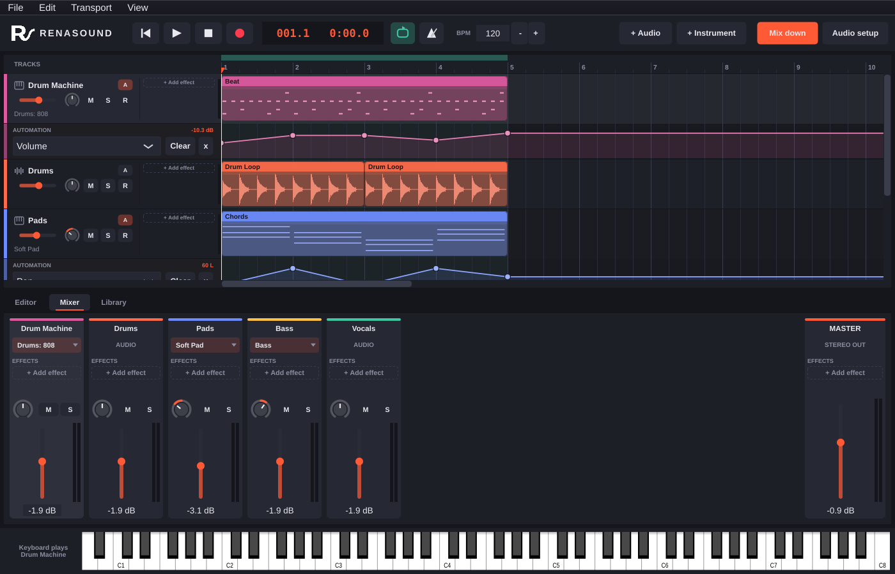
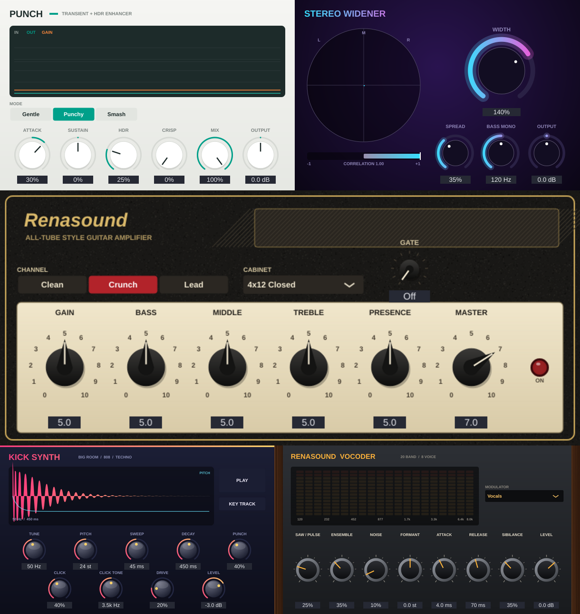

<p align="center"></p>

# RENASOUND

A Mixcraft-style music DAW for **macOS and Windows**, written in C++ with JUCE.



## What's new in 0.9

- **New faceplates for the built-in effects**, each with its own look and live graphics:
  - **Compressor:** a VU needle for gain reduction, the dynamics curve with the live level riding on it, and gain reduction over time.
  - **Reverb:** a 3D room shaped by Size and Width, with walls that soften with Damping and wavefronts that start after the pre-delay.
  - **Delay:** every echo as a bar in time, left and right for ping-pong, getting duller with Tone.
  - **EQ:** draggable band points on the curve. **Tube EQ:** enamel panel, a glowing tube and a small curve screen.
  - **Noise Gate:** level against the threshold with an open / closed light. **Gater:** the step pattern with a playhead. **Phaser:** sweeping notches. **Chorus:** drifting voices.
- **Presets on every device** (built-in effects and instruments, and plugins): a preset bar with Save, Delete, Default and previous / next. Presets live in Music/RENASOUND/Presets.
- **Musical typing:** the piano button next to BPM lets the computer keyboard play the selected instrument (A to ; white keys, W E T Y U O P black keys, Z / X octave, C / V velocity).
- **An input on each channel:** audio tracks record from any input or stereo pair of your interface, and several armed tracks record at once; instrument tracks can listen to all MIDI or to one controller.

## What's new in 0.8

**Look:** "black sandstone": warm near-black with a fine stone grain, sand accents, and borderless buttons that only light up on hover or when switched on.

**Update button** (next to Audio setup): checks GitHub for a newer build at start-up; one click downloads it, installs it and restarts RENASOUND.

**Arrangement**
- **+ Audio, + Instrument, + Vocoder, + Sampler, + Master** above the tracks. + Vocoder adds a Vocoder track already listening to your vocal track; + Sampler adds a Sampler track ready to play; + Master shows the master track for master volume and master-effect automation.
- Every track has an **automation** icon between S and R.
- Click the **clock** to switch between bars.beats.16ths and minutes:seconds (the ruler follows).
- **Trackpad gestures** like Adobe's apps: pinch to zoom, two-finger swipe to scroll, Option/Cmd + scroll to zoom (add Shift in the editors for note height) - in the timeline, piano roll and pitch editor.

**Piano roll**
- Tools: **Select** (V: click / box-select, move, resize), **Edit** (E: drag up/down for velocity, edges for length), **Draw** (D: click to write, drag for length).
- **Right-click menu**: cut, copy, paste here, duplicate, delete, select all / none, quantize, transpose, velocity (set, softer, louder, humanize), length (double, halve, grid, legato), tool and grid. Keys: Cmd+A/C/X/V/D, Delete, arrows (Shift = octave).

**Sampler** (new instrument): drop any sound (file or Library) and play it across the keyboard. Keys / One-shot / Drum modes, 16 voices, draggable start/end, loop, ADSR, filter, velocity; starts with a built-in "Glass Keys" sound.

**RENASOUND Drums, redesigned and shapeable**: glowing pads coloured by family with waveform thumbnails, a screen that draws the selected pad's sound and shape. Every pad: Level, Tune, Pan, **Decay, Tone, Attack, Drive** (also on your own samples). Synthesised kits add **character** controls that rebuild the sound: Sweep / Click (kick, toms), Snappy / Body (snares), Snappy / Spread (clap), Ring / Metal (hats, cymbals).

## What's new in 0.7.1

- **Instrument picker on every instrument track**: the instrument's name sits under the track name; click it to choose a RENASOUND synth sound, a drum kit (including your own kits), Kick Synth, Vocoder or a plugin, or to open the instrument's window. **+ Instrument** asks which instrument the new track should play.
- **Your sample packs in the Library**: kit folders (e.g. a "Renasound kits" folder in Music, Documents or Documents/Music) appear in the Library automatically, and the folder menu lists each subfolder (Kicks, Congas, Shakers...) so you can browse by type. Drag any sound onto the timeline.

## What's new in 0.7: five new devices, each with its own faceplate, and your own drum kits



Each device has its own look, in the spirit of its kind of gear (all original designs):

- **Punch** (effect, clean "lab" panel): transient shaper and HDR enhancer. **Attack** adds or softens snap, **Sustain** brings up or tucks the body, **HDR** lifts quiet detail without touching the peaks, **Crisp** adds top-end bite, with Gentle / Punchy / Smash modes, Mix and a live in/out/gain history. A soft ceiling stops boosted hits from clipping.
- **Stereo Widener** (effect, neon panel): Width (0-200%), **Spread** (a delayed copy of the middle added to the sides only, so it widens but cancels out completely in mono), **Bass Mono** keeps the lows centred, plus a goniometer and correlation meter.
- **Amp** (effect, amp head with tolex and a cream panel): Clean / Crunch / Lead channels (4x oversampled), Gain, Bass, Middle, Treble, Presence, Master, a noise Gate and cabinets (1x12 Open, 2x12 Combo, 4x12 Closed, or none).
- **Kick Synth** (instrument, neon pink): pitch-swept kick with Tune, Pitch, Sweep, Decay, Punch, Click, Click Tone, Drive and Level, an optional Key Track (C2 plays the Tune frequency), a live waveform and pitch view, and a Play button.
- **Vocoder** (instrument, wood-and-amber hardware look): 20 bands, 8-voice carrier synth. Put it on an instrument track, pick your vocal track as the **Modulator**, and play chords on the vocoder's track. Mute the vocal track if you only want the robot voice; the vocoder still hears it. Saw/Pulse, Ensemble, Noise, Formant shift, Attack, Release, Sibilance and Level, with band meters.

Instruments are in the instrument menu under **RENASOUND INSTRUMENTS**; effects are in **+ Add effect**.

**Your own drum kits.** RENASOUND Drums now reads kit files (`.rskit`), small XML files that name a sample for each pad (relative to the kit file) with its level, tune and pan. Kits appear under **YOUR KITS** in the kit menu and as **Drums: <kit>** in the instrument menu. RENASOUND looks in `Music/RENASOUND Kits`, `Documents/RENASOUND Kits` and any folder you add with **Add kits folder...** in the kit menu. Samples stay where they are and are never copied into RENASOUND, so sample packs whose licence forbids including them in software can still be used in your music.

```xml
<RENASOUND_KIT name="Tribal">
  <PAD note="36" file="ProducerSpot-Tribal-Drums/Kicks/Tribal-Kick-73.wav" level="0" tune="0" pan="0"/>
  ...
</RENASOUND_KIT>
```

Under the hood: tracks can now listen to other tracks (sidechain routing), the engine orders tracks so the source runs first, and the choice is saved with the project.

## What's new in 0.6: Dynamic EQ and Tube EQ

Two studio EQs join the effect list (**+ Add effect**):

**Dynamic EQ** (in the style of a 6-band dynamic EQ like Waves F6). Six bands — each a low shelf, bell or high shelf — plus low cut, high cut and output, drawn over a live spectrum analyser.

- drag a numbered point to set its frequency and gain, scroll over it for Q, double-click to switch it off
- turn on **Dynamic** for a band and it reacts to the level in its own frequency range: above the **Threshold** it moves by up to its **Range** (negative = cut when loud, e.g. taming harsh "s" sounds or a boomy note; positive = boost when loud), with its own **Attack** and **Release**. The shaded area shows how far a band can move, and the line shows where it is right now
- the band panel shows the band's live level while you set the threshold

**Tube EQ** (in the spirit of the classic passive tube EQs like the Pultec EQP-1A). Stepped **Low Freq** (20/30/60/100 Hz) with separate **Low Boost** and **Low Atten** — turn both up for the famous tight-low-end trick: a bump at the bottom and a dip just above it. **High Freq** (3k–16k) bell with **Bandwidth**, a **High Atten** shelf (5k/10k/20k), and a **Tube Drive** stage (oversampled) that adds warmth and mostly 2nd-harmonic colour on loud parts while leaving quiet material at unity.

Every knob on both can be automated.

## What's new in 0.5: pan, automation, drums, Ableton Live sets

**Pan knobs** on every track header and mixer strip. Drag up/down, double-click to centre; the arc fills from the middle so you can see at a glance which side a track sits on.

**Automation, Mixcraft-style.** Click the **A** button on a track (or right-click the header > *Add automation lane...*) and pick what to automate: Volume, Pan, any knob of the track's instrument, or any knob of any effect on the track (built-in or VST/AU). Lanes open under the track:

- click to add a point (it snaps to the grid; hold Shift for free placement), drag points to move them
- double-click, Alt-click or right-click a point to delete it
- the lane header shows the parameter, its current value, **Clear** and **x** (remove lane); **A** shows/hides all lanes
- while playing, the faders, pan knobs and effect knobs follow the automation; it's saved with the project, included in undo, and used in mixdowns

**RENASOUND Drums**, a built-in drum machine. Pick it from the instrument menu (*RENASOUND DRUMS* section) on any instrument track. Five synthesised kits — **808, 909, Trap, Lo-Fi, House** — with 16 pads on General MIDI drum notes (kick C2/36, snare D2/38, clap, rim, closed/open hats that choke each other, three toms, crash, ride, cowbell, tambourine, shaker, clave, second snare), so any GM drum MIDI file plays correctly. In the pad window:

- click a pad to hear it; drop any audio file onto a pad to replace that sound
- **Load sample folder...** builds a kit from a folder of one-shots (it matches names like kick, snare, hat, clap...)
- per-pad Level, Tune and Pan, plus Kit Volume — all of them automatable
- the piano roll shows pad names on the keys for drum tracks

Drum tracks in imported Mixcraft and Ableton projects come in on RENASOUND Drums automatically.

**Ableton Live sets (.als)** open with *File > Open*, *File > Import Ableton Live or Mixcraft project...*, or by dragging onto the timeline (Live 9 to 12). It brings across the tempo, audio and MIDI tracks with names, volume, pan and on/off, arrangement clips with their positions, loops and trims, every MIDI note, track volume/pan automation, and — if the arrangement is empty — the Session view's scenes laid out one after another. Drum Racks and Impulse become RENASOUND Drums (Impulse slots are remapped to GM notes). Live's own instruments and effects can't come across, and warped audio plays at its original speed because RENASOUND doesn't time-stretch yet; missing samples can be located the same way as for Mixcraft.

## What's new in 0.4: open Mixcraft projects

**File > Open** (or **File > Import Mixcraft project...**, or just drag the file onto the timeline) opens Mixcraft **.mx9 / .mx10** projects, and probably neighbouring versions too. Mixcraft's format is undocumented, so this was worked out from real projects. It brings across:

- the tempo, every audio and MIDI track with its name, volume, pan and mute
- audio clips in the right places with their trims, and crossfades where clips overlap
- MIDI clips with all their notes (looped clips are unrolled)

Mixcraft's built-in instruments and effects only exist inside Mixcraft, so instrument tracks get a matching RENASOUND synth sound (swap it for any plugin), and automation isn't copied. If audio files aren't next to the project, RENASOUND lists them and lets you point to the folder that has them (it searches subfolders). Save afterwards to keep it as a .renasound project.

## What's new in 0.3: pitch editing

Double-click any audio clip of a single voice or instrument (vocals, sax, bass...) and the **Editor** tab shows its notes as blobs, Melodyne-style. RENASOUND finds the notes by itself the first time (a few seconds in the background).

- **Drag a note** up or down: it lands exactly on a semitone (hold **Alt** to move it freely). A faint outline shows where it was sung.
- **Double-click a note** to put it right on the nearest note of the scale.
- **Snap to scale** fixes the selected notes (or all of them) in one click. Pick the song's **key** and **Major / Minor / Chromatic** first.
- **PITCH** slider: pull notes partway toward the scale (0-100%) for a natural result.
- **DRIFT** slider: flatten the wobble inside each note (100% = dead straight, the "auto-tune" sound).
- **Cmd/Ctrl-click** a note to split it where two notes were joined. **Shift-click** or drag a box to select several; **Up / Down** arrows move selected notes a semitone (Shift: an octave). **Reset** removes the edits; **A/B** lets you compare with the original.
- The white line inside each blob is the pitch you'll hear after your edits.
- The new audio is made in the background with PSOLA re-synthesis, which keeps the voice sounding like itself. Edits are saved in the project and work with undo.

Works best on clean, dry, single-voice recordings. Chords, backing vocals in the same clip and very noisy takes won't be split into notes properly.

## What's new in 0.2

- **Effects on every track and on the master bus, right on the mixer's channel strips.** Each strip lists its effects: click **+** to add one, click an effect's name to open its controls, click its light to bypass it, drag it up or down to change the order, and hover + click **x** (or right-click) to remove it. Instrument tracks show their instrument at the top of the strip: click it to open it, or the arrow to change it. The same effect list also sits on every track header in the timeline, next to M / S / R, and works the same way.
  - **EQ**: low cut, low shelf, mid bell, high shelf, high cut, with a live response curve
  - **Compressor**: threshold, ratio, attack, release, makeup, mix, with a gain-reduction meter
  - **Reverb**: size, damping, width, pre-delay, low cut, mix
  - **Delay**: tempo-synced (1/4, 1/8, dotted, triplet...) or free time, feedback, tone, ping-pong
  - **Noise Gate** and **Gater** (rhythmic, tempo-synced volume chopping with patterns)
  - **Phaser** and **Chorus**
- **Third-party plugins**: VST3 on Mac and Windows, plus Audio Units on Mac. Open **File > Plugins** (or *Scan for plugins...* in any add menu), press **Scan / options...** and choose your plugin format to scan. Plugins then show up next to the built-in effects, grouped by maker. Plugin windows open inside the channel window.
- **Plugin instruments**: click the arrow next to an instrument track's sound on its mixer strip to swap the built-in synth for any VST3 / AU instrument.
- Effects and plugin settings are saved in the project and survive undo / redo. Tempo-synced effects and plugins follow RENASOUND's tempo and transport.
- New RENASOUND logo and app icon.

## What's in version 0.1

- **Multitrack timeline**: audio and instrument tracks; drag clips to move them (even between tracks), drag a clip's right edge to trim it, right-click for split / duplicate / delete. Waveforms and note previews are drawn on the clips.
- **Recording**: arm a track (**R**) and press record. Audio tracks record from your mic or audio interface; instrument tracks record what you play on a MIDI keyboard, the on-screen piano or your computer keyboard. Pressing record with nothing armed arms the selected track for you, like Mixcraft.
- **Instruments**: a built-in synth with 7 sounds (Saw Lead, Soft Pad, Pluck, Bass, E-Piano, Square Keys, Sub Bass). Double-click an instrument lane to create a MIDI clip and edit it in the **piano roll** (click to add notes, drag to move / resize, right-click or double-click to delete, Quantize).
- **Mixer**: volume fader, pan, mute, solo and stereo meters per track, plus a master strip with a soft clipper so overs don't crackle.
- **Library**: every take you record is saved to `Music/Renasound/Recordings` and shows up here automatically. Add your own folders of loops and samples too. Double-click to preview, drag onto the timeline to use.
- **Transport**: play / pause, stop (press twice to go back to the start), loop (shift-drag in the ruler to set the region), metronome, tempo.
- Undo / redo, save / open `.renasound` projects, import WAV / AIFF / FLAC / MP3, **Mix down** to a WAV file.

### Shortcuts (Cmd on Mac, Ctrl on Windows)

| Key | Action | Key | Action |
|---|---|---|---|
| Space | Play / pause | R | Record |
| Home / Enter | Back to start | L | Loop on/off |
| C | Metronome | S | Split clip at playhead |
| Delete | Delete clip | Cmd+D | Duplicate clip |
| Cmd+Z / Cmd+Shift+Z | Undo / redo | Cmd+T / Cmd+Shift+T | Add audio / instrument track |
| Cmd+I | Import audio | Cmd+E | Mix down |
| Cmd + mouse wheel | Zoom | Cmd+1 / 2 / 3 | Editor / Mixer / Library |
| Cmd+F | Add effect to selected track | Cmd+Shift+F | Add effect to master |
| Cmd+Shift+P | Plugin manager | | |

Click the on-screen piano first to play it with your computer keys (A W S E D F T G Y H U J K).

## Getting the app

### Easiest: let GitHub build it for you

1. Put this folder in a new GitHub repository and push it.
2. Open the repo's **Actions** tab. The *Build* workflow compiles the Mac and Windows versions (about 10 minutes).
3. Download **Renasound-macOS** or **Renasound-Windows** from the finished run.

The Mac app isn't signed by Apple yet, so the first time, macOS may refuse to open it. Fix it once in Terminal:

```
xattr -cr /Applications/RENASOUND.app
```

### Build it yourself on a Mac

Install Xcode from the App Store and CMake (`brew install cmake`), then in this folder:

```
cmake -B build -G Xcode
cmake --build build --config Release
open build/Renasound_artefacts/Release/RENASOUND.app
```

To work on the code in Xcode, open `build/Renasound.xcodeproj`. The first configure downloads JUCE automatically.

### Build it yourself on Windows

Install Visual Studio 2022 (with "Desktop development with C++") and CMake, then:

```
cmake -B build
cmake --build build --config Release
build\Renasound_artefacts\Release\RENASOUND.exe
```

Or open `build\Renasound.sln` in Visual Studio. For low-latency recording on Windows, pick an ASIO driver for your interface in **Audio setup** (ASIO needs Steinberg's ASIO SDK enabled in the build; WASAPI works out of the box).

## Project layout

```
Source/
  Main.cpp            app + window + menu bar
  MainComponent.*     transport bar, layout, commands, file handling
  Model.*             project data: tracks, clips, notes, undo, save/load
  AudioEngine.*       playback, recording, metronome, preview, mixdown, plugin hosting
  Effects.*           the built-in effects and their knob editor
  StudioEq.cpp        Dynamic EQ (with its own editor and analyser) and Tube EQ
  Devices.*           Punch, Stereo Widener, Amp, Kick Synth, Vocoder and their faceplates
  DspHelpers.h        biquad filters and parameter helpers
  Pitch.*             note detection (YIN), PSOLA pitch shifting, background service
  MixcraftImport.*    reads Mixcraft .mx projects
  AbletonImport.*     reads Ableton Live .als sets
  Drums.*             RENASOUND Drums: synthesised kits, pads, pad editor
  Synth.h             the built-in synth and its presets
  UI/                 timeline, piano roll, mixer, effect slots (InsertList, shared by headers and strips), library, device windows, pitch editor, theme
Resources/            logo and app icon
Tests/RenderTest.cpp  headless test (cmake -DRENASOUND_TESTS=ON)
```

## Ideas for next versions

Plugin delay compensation · effect presets · sends / aux buses · loop tempo-stretching · recording latency compensation · bundled open-source instruments · step sequencer for the drum machine.

Known limits: plugins load on the main thread (big ones can take a second), AUv3-only plugins aren't supported yet, and plugin latency isn't compensated.

## License note

RENASOUND is built on [JUCE](https://juce.com), which is free under the AGPLv3 (your source must stay open if you distribute the app) or under JUCE's commercial licence (see juce.com for its tiers). Check which fits before you sell or publish it.
